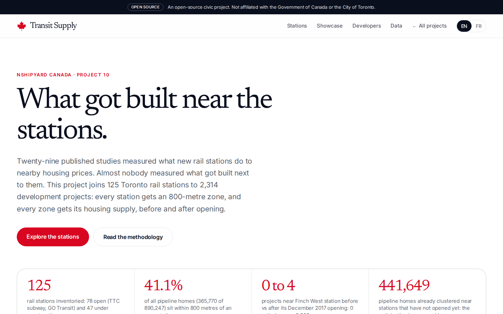
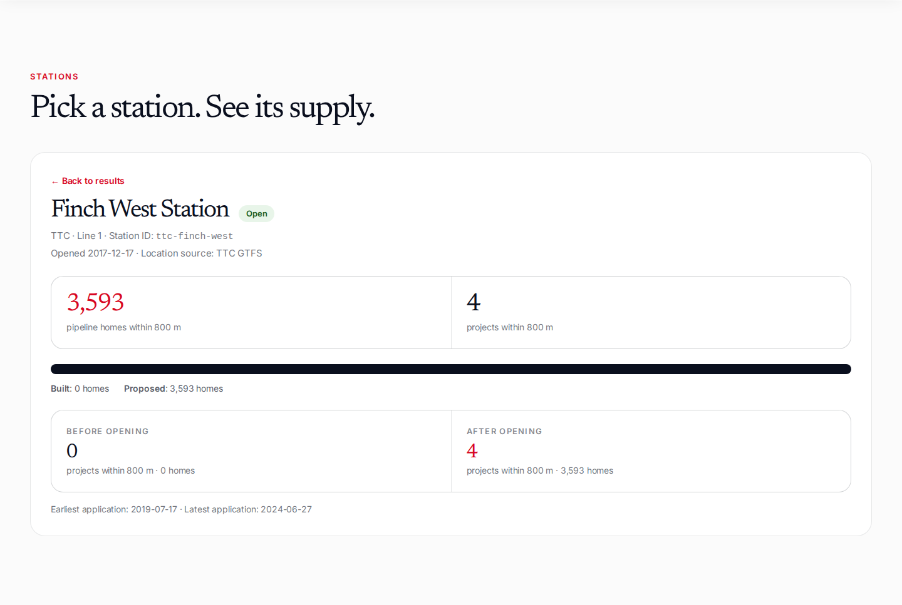
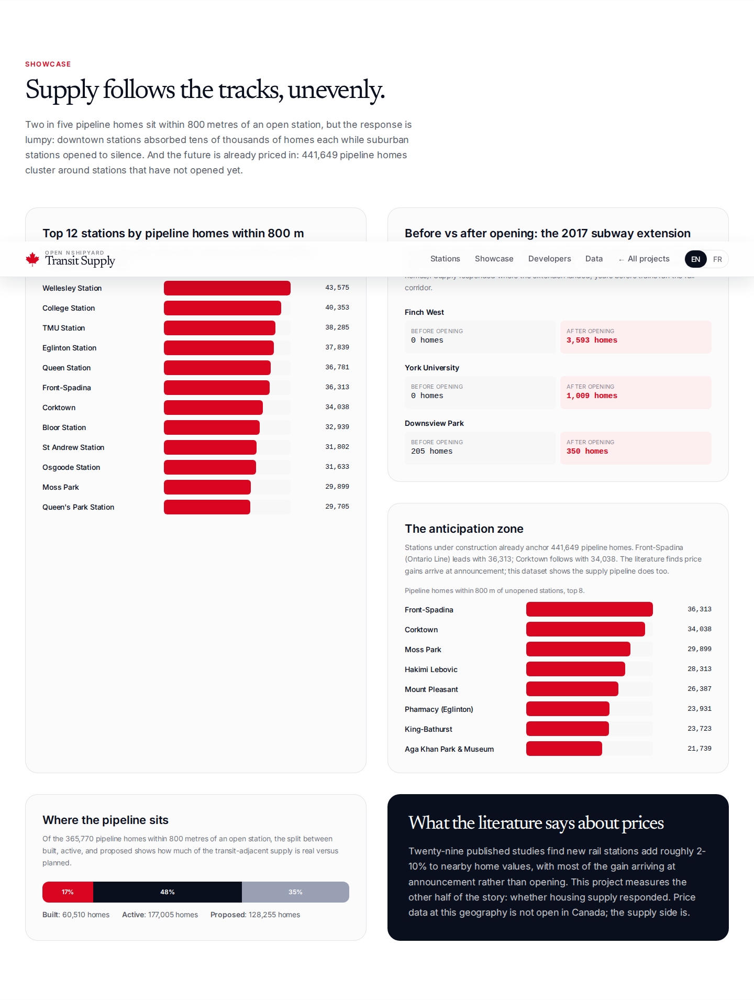
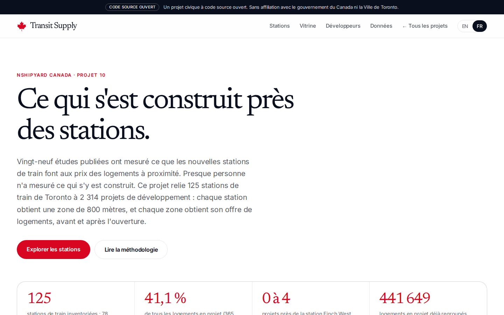
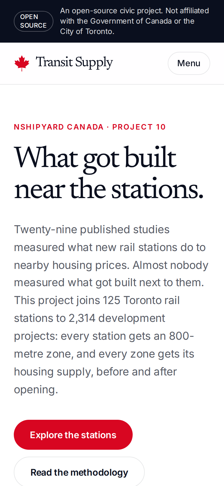
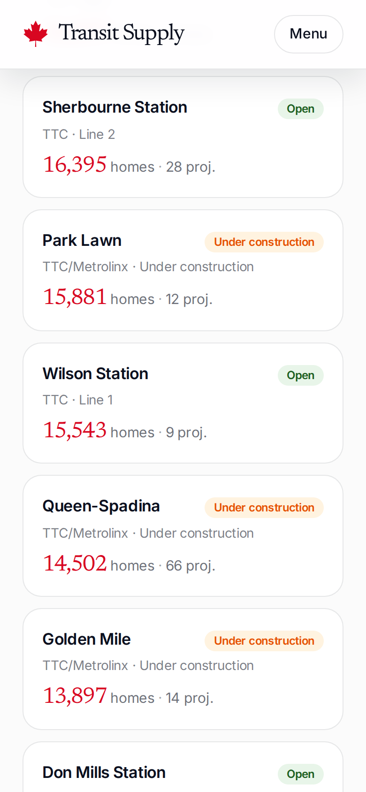

# canada-transit-supply

What got built near the stations: 125 Toronto rail stations joined to 2,314 development projects, measuring the housing supply response within 800 metres of each station, before and after opening. Nshipyard Canada project 10.

Twenty-nine published studies measured what new rail stations do to nearby housing prices. Almost nobody measured what got built next to them. This project is that missing half: every Toronto rail station (TTC subway, GO Transit regional rail, UP Express airport link, plus 47 stations under construction on the Eglinton Crosstown, Ontario Line, and Scarborough extension) gets an 800-metre zone, and every zone gets its housing supply from the City of Toronto Development Pipeline, split by project status and by whether the application arrived before or after the station opened.

Live at https://supply.canada.nshipyard.com (English and French).

An open-source civic project. Not affiliated with the Government of Canada or the City of Toronto.

## Screenshots

## What the data shows

- 41.1% of Toronto's development pipeline, 365,770 of 890,247 homes across 860 projects, sits within 800 metres of at least one open station. Projects near several stations are counted once in this share; per-station figures double-count shared projects and are correct only per station.
- Supply responded where the 2017 Toronto-York Spadina subway extension landed. Finch West station went from 0 nearby projects to 4 (3,593 homes) after its December 17, 2017 opening; York University from 0 to 5 (1,009 homes); Sheppard West from 0 to 6 (3,042 homes). Every application near Finch West arrived after opening day, the earliest in July 2019.
- The anticipation is measurable: 441,649 pipeline homes already cluster around stations that have not opened yet. Front-Spadina (Ontario Line, a new Metrolinx subway line under construction) leads with 36,313 homes; Corktown follows with 34,038. The literature finds price gains arrive at announcement; this dataset shows the supply pipeline does too.
- The response is lumpy. Downtown stations absorbed tens of thousands of homes each (Wellesley 43,575; College 40,353; TMU 38,285) while some suburban stations opened to near silence.
- Of the 365,770 transit-adjacent homes, 177,005 are active, 128,255 proposed, and 60,510 built. Less than one in six of the homes near open stations exists yet.
- Context from the literature, not from this file: 29 published studies find new rail stations add roughly 2-10% to nearby home values, with most of the gain arriving at announcement rather than opening. Parcel-level sale prices are not open data in Ontario (Teranet, the provincial land registry operator, is proprietary), so this dataset measures the supply response, which is the half nobody had built.

## How it was built

1. Station inventory: 73 TTC (Toronto Transit Commission) subway stations located exactly from the TTC GTFS feed (Toronto Open Data, retrieved 2026-10-08). GO Transit stations and 47 under-construction stations located from the City's Major Transit Station Areas shapefile (January 2026), converted from MTM Zone 10 (NAD27) with a hand-written inverse Transverse Mercator projection and calibrated against 58 GTFS stations (median residual 27 metres).
2. Opening dates: TTC dates are exact, compiled from TTC public records (1954-03-30 for the original Yonge segment through 2017-12-17 for the Toronto-York Spadina extension). GO station dates are approximate years. Future stations carry no opening date.
3. Housing supply: City of Toronto Development Pipeline analytical file (retrieved 2026-10-08), 2,391 projects, of which 2,314 geocoded, with status (proposed, active, built), proposed units, and application receipt date. Each project is joined to stations by haversine distance within 800 metres.
4. Citywide totals are deduplicated across overlapping station zones. Before/after comparisons use the application receipt date, which is not a completion date: they measure application timing around openings, capturing anticipation as well as response.

Run `python3 scripts/build_data.py` to regenerate `data/` from the raw inputs, then copy the three JSON files into `public/data/` to keep the downloads in sync.

## Files

- `data/stations.json` - 125 stations: id, name, agency, lines, lat/lon, opening date and precision, status, coordinate source
- `data/supply_by_station.json` - per-station supply: projects and homes within 800m, split by status, earliest/latest application, before/after opening where the opening date is exact
- `data/summary.json` - aggregates: headline shares, top 12 stations, top 8 future stations, 2017 extension before/after sample, status split
- `public/data/` - byte-identical mirrors of the three files, served as downloads
- `scripts/build_data.py` - the full pipeline: GTFS parsing, MTSA projection, opening-date table, 800m join, dedup headline stats

## API

REST under `/api/v1/`, OpenAPI 3.1 at `/api/openapi.json`:

- `GET /api/v1/station/search?q=finch&status=open&limit=60` - search stations
- `GET /api/v1/station/lookup?station_id=ttc-finch-west` - one station with its supply
- `GET /api/v1/supply/summary` - the headline aggregates

MCP over streamable HTTP at `/mcp` with three tools: `station_lookup`, `station_search`, `supply_summary`. The Developers section of the site has tabbed connect instructions (ChatGPT, Claude, Claude Code, CLI, other).

## What this does not have

CMHC (Canada Mortgage and Housing Corporation) housing completions and Toronto building permits are named in the project brief as desired sources. They are not in this build: the supply side here is the development pipeline (applications and their status), not completed homes. The `built` status in the pipeline file marks projects the City's analytical file records as complete, which is the closest this dataset gets to completions. Adding CMHC completions and permit issuance per station zone is the documented next step.

## Author

**Richardson Dackam** - [X (@richardsondx)](https://x.com/richardsondx) · [GitHub](https://github.com/richardsondx)
